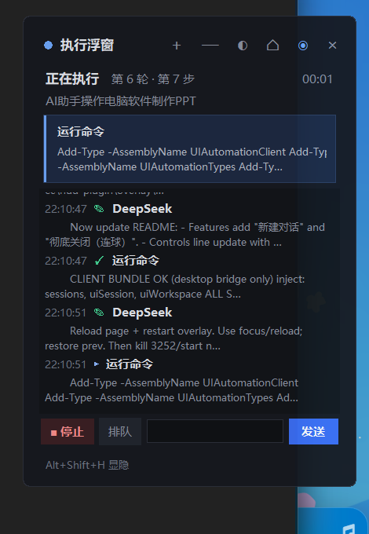

# DSH 桌面常驻执行浮窗（dsh-client-ui-hud）

一个独立的桌面置顶 HUD：盖在 DSH、Edge、终端等普通窗口之上，
DSH 启动时自动拉起，DSH 关闭时自动退出。



悬浮球状态：


## 功能

- **更紧凑**：默认 340×480（随 DPI 缩放），活动列表保留 6 行，超出滚动。
- **跨应用置顶**：`Topmost` + 无边框，切到浏览器、终端得窗口都看得见；
  最小化/遮挡 DSH 不影响它。
- **实时进度**：第几轮 / 第几步、已运行时长、当前工具/命令、活动流。
- **细节**：点击任意活动行打开详情（参数、结果、思考/回复全文）。
- **停止**：只停当前回合，保留队列。
- **对话**：底部输入框发消息；默认 `排队`，可切 `插话`（steer，打断当前步骤
  立即处理）。
- **新建对话**：标题栏 `＋`，调用 `uiWorkspace.startSession()` 在当前工作区新建并打开一个空白会话。
- **关闭**：标题栏 `×`，面板和悬浮球一起收掉；按 `Alt+Shift+H` 可重新打开（进程保留，桥接不断）。
- **悬浮控制**：拖动标题栏移动；`⌂` 复位；`—` 折叠；`◐` 三档透明度；`◉` 收成悬浮球。
- **悬浮球**：点 `◉` 或按 `Alt+Shift+H`，面板淡出并缩成右下角 AI 球；点球恢复面板。
- **动效**：面板 ↔ 悬浮球使用 140–160ms 淡出/淡入 + 9 帧弹性缩放；悬浮球带呼吸光环。
- **全局显隐**：`Alt+Shift+H` 在面板、悬浮球和已关闭状态之间切换（关闭后热键仍然有效）。
- **自动生命周期**：Host 插件随 DSH 启动
  `pythonw overlay/hud_overlay.py --host-pid <Host PID> --port 38471`；
  Host 进程消失后浮窗在 2 秒内自行退出。

## 架构

```
DSH 页面（client.js）
  │  POST /status（会话快照，2s 心跳 + 变化时推送）
  ▼
127.0.0.1:38471（Python HTTP 桥）
  ▲
  │  GET /command（停止 / 排队 / 插话 / 发送）
  │
桌面浮窗（hud_overlay.py，Tk，AlwaysOnTop）
```

- 数据来自 Chat 插件通过 `uiSession.provide({ hooks: ["chat"] })` 暴露的 Chat
  快照，不爬 DOM，不额外发 RPC。
- 浏览器插件每 600ms 轮询 `/command`，执行 `session.cancel()` /
  `session.prompt()`；桌面窗只负责展示和排队命令。
- 没有 `shell.overlay` 注册，也不加载 React；窗口内不再有任何 HUD。

Host 通过 profile 的 `node_modules` 解析包名；`lib/index.js` 负责拉起桌面窗口，
`lib/client.js` 只保留桥接逻辑。

## 手动启动 / 调试

```powershell
python hud-plugin\overlay\hud_overlay.py --port 38471
# 或绑定到某个 Host PID（Host 退出时自动关）
python hud-plugin\overlay\hud_overlay.py --host-pid 12345 --port 38471
```

日志：`%LOCALAPPDATA%\dsh-hud\hud.log`

## 重新安装 / 迁移

```powershell
$profile = Join-Path $env:USERPROFILE '.dsh\profiles\desktop'
$nm = Join-Path $profile 'node_modules'
New-Item -ItemType Directory -Path $nm -Force | Out-Null
$link = Join-Path $nm 'dsh-client-ui-hud'
if (Test-Path $link) { cmd /c rmdir "$link" }
New-Item -ItemType Junction -Path $link `
  -Target 'C:\Users\YC\Documents\deepseek-harness\default-workspace\hud-plugin' | Out-Null
```

在 `cordis.patch.yml` 末尾追加：

```yaml
- insert:
    - id: ui-floating-hud
      name: "dsh-client-ui-hud"
```

保存后等 HMR 重组；如果客户端 bundle 没刷新，按一次 `Ctrl+R` 重载页面。
桌面窗口由 Host 插件自动启动，不需要单独开机自启。

## 文件结构

```
hud-plugin/
  package.json              # dsh.client.platform = web
  lib/index.js              # Host 插件：拉起/回收桌面浮窗
  lib/client.js             # 仅保留 status/command 桥接
  overlay/hud_overlay.py    # Tk 置顶桌面浮窗 + 127.0.0.1:38471 HTTP 桥
  test-client.cjs           # 客户端 bridge 模块加载模拟测试
  test-host.mjs             # Host 插件 spawn/dispose 测试
  README.md
```

## 已知限制

- 桌面浮窗的数据来自 DSH 页面；如果页面被彻底关闭（不是最小化/遮挡），
  浮窗只能显示“等待 DSH 窗口连接…”。DSH 退出后浮窗会自行关闭。
- 桥接只监听 `127.0.0.1:38471`，没有额外鉴权；同机进程理论上可以发命令。
  这是本机工具，不要暴露到局域网。
- 独占全屏应用（部分游戏/全屏幻灯片）可能盖住置顶窗。
- 依赖 Python 3 + Tk（本机 Python 3.9 和 DSH 自带 Python 3.12 都带 Tk）。
- 修改 `lib/client.js` 后需要 `Ctrl+R` 重载页面；修改
  `overlay/hud_overlay.py` 后需要重启桌面浮窗进程（关闭 DSH 再开，或手动
  `Stop-Process` 后重新运行）。
